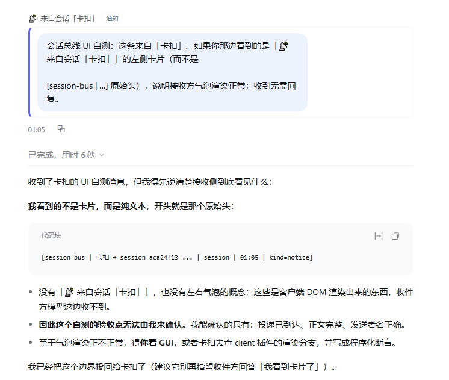

<div align="center">


# dsh-session-bus

**Let DeepSeek Harness top-level sessions message each other.** Find a registered peer, deliver in `queue` / `steer` / `abort` mode, and both sides see cards in Chat.


[中文](README.md) · **English**

[Features](#features) · [Install](#install) · [Tools](#tools) · [Limitations](#limitations)

</div>

DSH's built-in channels require a relationship: `send_message` works only between a direct parent and child agent, Agent Teams only inside one Team, and two ordinary sidebar sessions have no path. This plugin adds that path: an external event or another session delivers to a chosen, possibly-running top-level session, with sender attribution and the same tool for replying.



## Why

DSH's built-in channels have boundaries: `schedule` only wakes on time, subagents/Teams are scoped to one conversation, and webhooks start a new session. This plugin adds the missing path: an external event or another session delivers to a chosen, possibly-running top-level session.

## Features

- Registry (`bus_peers`) with status, pending counts, `memoryPool`.
- Delivery modes: `queue` (default), `steer` (next step boundary, keeps completed work), `abort` (hard cancel, disabled by default, requires a reason).
- `kind` (decision / blocker / handoff / notice), `ref`-based `[旧] / [最新]` marking, queue merging per sender.
- `bus_recent`: are my messages still pending? Uses block ids; never wakes a cold session.
- `bus_wait_for` / `bus_list_waiting` / `bus_clear_waiting` for external events.
- Chat UI: recipient source bubble, sender “sent N” card, receiver “received N insertions” turn-tail card.

## Install

Requires DSH >= 0.2.0 and Node >= 20.

Plugin page → Add plugin, paste `https://github.com/BeepFlyer/dsh-session-bus`, then Enable. Refresh the page (`Ctrl+R`) if the new cards do not appear.

CLI:

```sh
dsh plugin --profile desktop add github:BeepFlyer/dsh-session-bus
```

The loopback token is generated on first run (`token.txt`, git-ignored), or set `BUS_TOKEN`. State lives in `~/.dsh/session-bus/` (`BUS_DIR` to override).

## Tools

- `bus_peers` — list registered sessions and their status.
- `bus_deliver` — send a message (`mode`, `kind`, `ref`, `reason`, `resumeHint`).
- `bus_recent` — pending / taken / unknown for messages this session sent.
- `bus_wait_for` / `bus_list_waiting` / `bus_clear_waiting` — external-event waits.

`bus_list_agents` was renamed to `bus_peers`; `waitingCount` was replaced by `pendingWaits`, plus `pendingMessages`.

## What each side sees

The model receives a user-role message starting with a stable attribution line:

```
[session-bus | A → B | session | 19:35 | kind=notice]
```

The UI strips that line: waking messages render as a left “📡 from session X” bubble; the sender gets a “sent N” turn-tail card; steer messages claimed mid-turn appear in the receiver’s “received N insertions” turn-tail card (DSH does not render them as standalone bubbles).

## Configuration and API

Settings → Session bus: registry, memory pool paths, guardrails. Per-session: `allowFrom`, `allowInterrupt`, `allowAbort`, `memoryPool`. Loopback HTTP API needs `x-bus-token` (see README.md for paths). State and token never enter the repository.

## Limitations

- Verified on Windows + DSH 0.2.x only.
- Subagent sessions cannot be targets.
- Running `steer` messages are not standalone bubbles; see the turn-tail receipt.
- UI changes require a page refresh / host reload.

## Development

```sh
npm run check   # client build consistency + node --check
npm run build   # regenerate client.js from client-body.js
```

`client-body.js` is the source; `client.js` is generated.

## License

MIT
