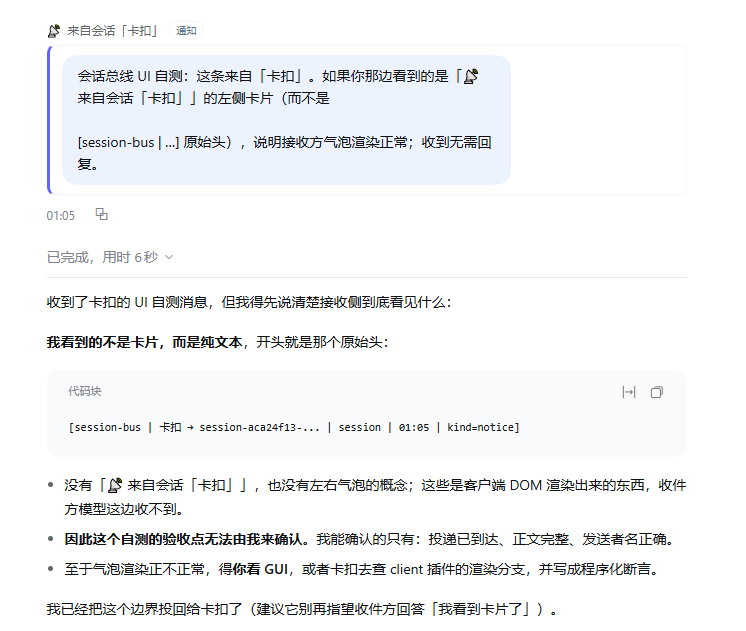
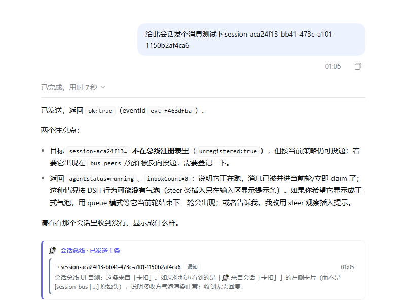
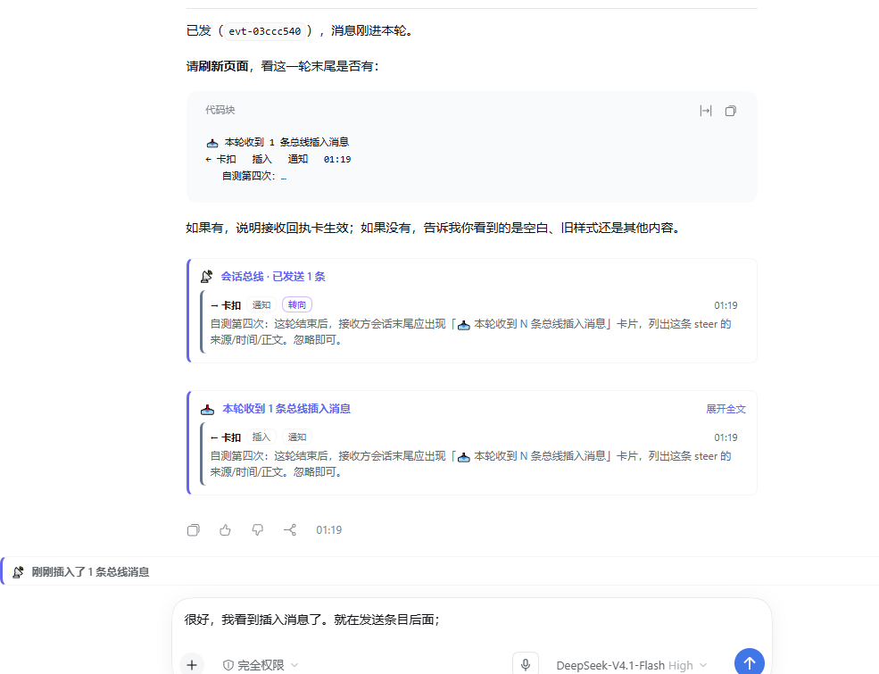

# dsh-session-bus

**让 DSH 的顶层会话互相发消息** —— 一个会话可以找到另一个已登记的会话、按需要排队/插队/急停，消息带来源、性质与合并标记；发送方和接收方在 Chat 里都能看到对应卡片。


<p align="center"><sub>接收方：左侧卡片「📡 来自会话「…」」+ 性质标签；正文复用官方用户气泡。</sub></p>


<p align="center"><sub>发送方：回合末的「📡 会话总线 · 已发送 N 条」卡片。</sub></p>


<p align="center"><sub>发送卡片 + 接收方回合末的「📥 本轮收到 N 条总线插入消息」回执。</sub></p>

---

## 为什么需要它

DSH 自带的“发起”通道各有边界：

| 已有能力 | 边界 |
|---|---|
| `schedule`（定时任务） | 触发源只有 rrule，只能按时间唤醒 |
| `subagent` / Agent Teams | 会话内部或同一 Team 内的隔离上下文，不是两个独立顶层会话 |
| `@deepseek-ai/dsh-webhook` | 每个事件开一个新会话，不能投递给指定会话 |

本插件补的是另一条线：**外部事件 → 匹配注册表 → 投递给指定的、可能正开着的顶层会话**，以及**会话之间直接投递**。

## 特性

- **注册表**：登记会话的 name / role / knows / allowFrom / memoryPool；`bus_peers` 查看谁在、状态、待处理数。
- **三种投递模式**：`queue`（默认，排到下一轮）、`steer`（插到下一个步骤边界，不丢已完成工作）、`abort`（硬中止，默认关闭且必须带理由）。
- **性质与合并**：`kind`（decision/blocker/handoff/notice）、`ref` 同一话题标记 `[旧] / [最新]`；queue 投递会合并进接收方同一发送方的待处理块，队列不会无限堆积。
- **可查**：`bus_recent` 按 `blockId` 查自己发过的消息还在不在对方队列里（非 live 会话返回“未知”，不唤醒）。
- **等待外部事件**：`bus_wait_for` 一次性等待项，命中即删、自动过期。
- **两侧 UI**：接收方显示来源气泡；发送方回合末显示已发送卡片；运行中插入的 steer 消息在接收方回合末汇总为回执卡。
- **设置页**：注册表 CRUD、memoryPool 路径总览、护栏参数、最近投递。

## 安装

要求：DeepSeek Harness ≥ 0.2.0、Node ≥ 20。插件本身不调用模型，不需要额外 API key。

### 方式一：插件页（推荐）

Harness 侧栏 **插件 → 添加插件**，填入仓库地址：

```text
https://github.com/BeepFlyer/dsh-session-bus
```

安装后点 **立即启用**；如果 Chat 里的卡片样式没出现，`Ctrl+R` 刷新页面。

### 方式二：命令行

```sh
dsh plugin --profile desktop add github:BeepFlyer/dsh-session-bus
```

本地开发（改代码直接作用于该副本）：

```sh
git clone https://github.com/BeepFlyer/dsh-session-bus
dsh plugin --profile desktop add link:/path/to/dsh-session-bus
```

首次启动会在插件目录生成 `token.txt`（仅本机 loopback HTTP 使用，已在 `.gitignore`），也可用环境变量 `BUS_TOKEN` 覆盖。存储目录默认 `~/.dsh/session-bus/`，可用 `BUS_DIR` 改。

## 快速开始

**会话之间发消息**（在任意会话里）：

> 用 `bus_peers` 看看谁在；给「七巧板」发一条 notice，告诉它接口字段改名了。

**外部事件唤醒**（在目标会话里登记）：

> 用 `bus_wait_for` 登记：我在等飞书图片，TTL 10 分钟。

外部进程 POST `/api/session-bus/signal`（带 `x-bus-token`）后，目标会话会收到一条带来源前缀的消息。

## 给 agent 的工具

| 工具 | 作用 |
|---|---|
| `bus_peers` | 列出已登记会话：状态、`pendingWaits`、`pendingMessages`、`memoryPool`、allowFrom/allowAbort |
| `bus_deliver` | 投递消息。`mode`: `queue`（默认）/ `steer` / `abort`；`kind`: decision/blocker/handoff/notice；`ref`: 同话题标记；`reason`/`resumeHint` 带上下文；`hop` 用于唤醒链 |
| `bus_recent` | 查自己发出的消息：`pending`（按 blockId 仍在对方队列）/`taken`/`unknown`（目标无 live agent，不唤醒） |
| `bus_wait_for` | 登记一次性外部事件等待（source + match + ttlSeconds） |
| `bus_list_waiting` | 列出本会话的等待项 |
| `bus_clear_waiting` | 清理本会话等待项（不传 id 清全部） |

回归提示：`bus_list_agents` 已改名为 **`bus_peers`**；旧字段 `waitingCount` 改名为 `pendingWaits`，并新增 `pendingMessages`。

## 消息在两边长什么样

**模型侧**：收到的消息是一条 user-role 消息，开头带稳定的来源行：

```
[session-bus | 大肥鱼 → 七巧板 | session | 19:35 | kind=notice]
```

这行是给模型判断来源与回复路径用的，不会被 UI 当成正文显示。

**UI 侧**：

- 唤醒型（queue）消息 → 接收方左侧「📡 来自会话「<名字>」」气泡 + 性质标签；
- 发送方 → 回合末「📡 已发送 N 条」卡片（收件人、性质、时间、摘要，可展开全文）；
- 运行中插入的 steer → 接收方回合末「📥 本轮收到 N 条总线插入消息」回执卡（DSH 不把运行中 claim 的消息画成独立气泡）。

## 设置与配置

设置 → 会话总线：注册表、memoryPool 路径、护栏、最近投递。

会话可配置项（注册表记录）：

| 字段 | 默认 | 说明 |
|---|---|---|
| `allowFrom` | `["*"]` | 允许谁投递给自己 |
| `allowInterrupt` | `true` | 是否接受 steer |
| `allowAbort` | `false` | 是否接受 abort（默认关闭） |
| `memoryPool` | 空 | 自己记忆池路径，`bus_peers` 返回给其他会话 |

全局护栏：`maxHop`、`maxPerMinute`、`minIntervalMs`、`defaultTtlSeconds`，见设置页。

## HTTP API

只监听 loopback，需要 `x-bus-token`（或用 `BUS_TOKEN`）：

| 方法 | 路径 | 说明 |
|---|---|---|
| POST | `/api/session-bus/signal` | 外部事件入窗（3 秒窗口），匹配后投递 |
| POST | `/api/session-bus/deliver` | owner 直接投递 |
| POST | `/api/session-bus/admin` | 脚本/admin 操作 |
| GET | `/api/session-bus/agents` | 注册表（含状态、pending 计数） |
| GET | `/api/session-bus/waiting` | 等待项 |
| GET | `/api/session-bus/log?limit=50` | 最近投递 |

浏览器设置页走同源 Cookie 栅栏的 `/api/session-bus-admin`，不暴露 token。当前地址写在 `<BUS_DIR>/origin.txt`。

## 存储与安全

- 存储：`~/.dsh/session-bus/`（`agents.json`、`waiting.json`、`settings.json`、`deliveries.jsonl`、`state/recent.jsonl`、`origin.txt`）。
- 只监听 loopback；`token.txt` 不入库；未注册投递会记 `unregistered: true` 与限频 warning。
- HMAC + 时间戳防重放可选（默认关），开启后 `x-bus-signature = HMAC-SHA256(secret, timestamp + "\n" + rawBody)`。
- 消息正文**不写进模型之外的第三处**：recent 只存投递记录（正文上限 4000 字），用于 UI 回执与 `bus_recent`。

## 已知限制

- 只在本机 Windows + DSH 0.2.x 实机验证；跨平台理论可行，未逐项验证。
- 子代理会话不能作为目标（`sessionController.prompt` 限制）。
- 运行中 `steer` 的消息不会被 DSH 画成独立气泡，只能靠回合末回执卡显示“插入了什么”。
- `steer` 的目标如果空闲，会自动降级为 queue；`abort` 需要 `allowAbort` 且必须带 `reason`。
- UI 改动需要刷新页面或重启 Host 才能加载新 client bundle。

## 开发

```sh
npm run check          # client 构建一致性 + node --check
npm run build          # 由 client-body.js 生成 client.js
```

客户端源码是 `client-body.js`，`client.js` 由 `scripts/build-client.mjs` 生成，**不要直接改 client.js**。

## 设计文档

- [SPEC.md](SPEC.md) —— 存储、匹配、护栏、HTTP API 的完整规格
- [SPEC-MESSAGE-GOVERNANCE.md](SPEC-MESSAGE-GOVERNANCE.md) —— 消息治理（kind、合并、ref 标记、bus_recent）的规格与验收

## 许可

MIT
